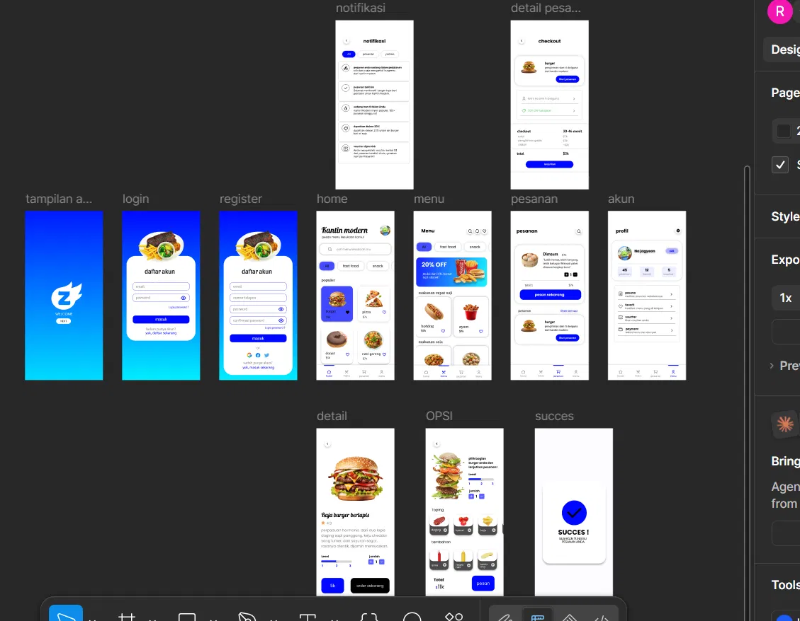

# 🍔 Kantin Modern — UI/UX Design (Tugas UPRAK)

Desain antarmuka (UI) aplikasi mobile **Kantin Modern**, yaitu aplikasi pemesanan makanan dan minuman kantin secara digital. Pengguna bisa melihat menu, memilih makanan, mengatur level dan topping, lalu memesan tanpa harus antre.

Desain dibuat di **Figma** sebagai tugas ujian praktik (UPRAK).



---

## 📌 Deskripsi Singkat

Kantin Modern mempermudah proses memesan makanan di kantin. Alurnya dibuat sederhana: **buka aplikasi → login → pilih menu → atur pesanan → checkout → selesai**. Tampilan memakai dominan warna **biru** dengan layout bersih dan card-based supaya mudah dibaca.

---

## 📱 Daftar Halaman (Screens)

Total ada **13 halaman**:

| No | Halaman | Deskripsi |
|----|---------|-----------|
| 1 | **Tampilan Awal** | Splash/welcome screen dengan logo dan tombol "Next" di atas background gradasi biru. |
| 2 | **Login** | Form masuk dengan email dan password, opsi "Lupa password?", dan link ke halaman daftar. |
| 3 | **Register** | Form pendaftaran (email, nomor telepon, password, konfirmasi password) plus opsi daftar lewat Google, Facebook, dan Twitter. |
| 4 | **Home** | Beranda dengan search bar, kategori (All, Fast Food, Snack), dan daftar menu populer dalam bentuk grid. |
| 5 | **Menu** | Daftar menu lengkap dengan filter kategori, banner promo (20% OFF), serta section "makanan cepat saji" dan "makanan asia". |
| 6 | **Pesanan** | Daftar pesanan yang sedang berjalan atau riwayat, dengan total harga dan tombol "pesan sekarang". |
| 7 | **Akun / Profil** | Info pengguna beserta statistik (pesanan, favorit, ulasan) dan menu pengaturan (pesanan, favorit, voucher, payment). |
| 8 | **Notifikasi** | Daftar notifikasi seperti status pesanan, promo, dan voucher, dengan tab filter (All, pesanan, promo). |
| 9 | **Detail Pesanan / Checkout** | Ringkasan pesanan, alamat/metode pengambilan, estimasi waktu, rincian biaya, dan total. |
| 10 | **Detail Menu** | Detail makanan (contoh: *Raja Burger Berlapis*) berisi foto, rating, deskripsi, pilihan level, jumlah, dan tombol order. |
| 11 | **Opsi** | Kustomisasi pesanan: level, jumlah, topping, dan tambahan, dengan total harga yang terhitung. |
| 12 | **Success** | Konfirmasi bahwa pesanan berhasil dibuat. |
| 13 | **Bottom Navigation** | Navigasi bawah yang dipakai di halaman utama: Home, Menu, Pesanan, Akun. |

---

## 🔄 User Flow

```
Welcome → Login / Register → Home
                               │
        ┌──────────────────────┼──────────────────────┐
        ▼                      ▼                      ▼
      Menu                  Pesanan                  Akun
        │                                              
        ▼                                              
  Detail Menu → Opsi (level, topping) → Checkout → Success
```

Halaman **Notifikasi** bisa diakses dari beranda.

---

## ✨ Fitur Utama (di Desain)

- 🔐 Autentikasi: login, register, dan social sign-in
- 🔍 Pencarian menu dan filter kategori
- 🍟 Daftar menu populer, banner promo, dan kategori makanan
- 🌶️ Kustomisasi pesanan: level pedas, jumlah, topping, dan tambahan
- 🧾 Checkout dengan rincian biaya dan total
- 🔔 Notifikasi pesanan, promo, dan voucher
- 👤 Profil pengguna: favorit, voucher, dan payment
- ✅ Halaman konfirmasi pesanan sukses

---

## 🎨 Desain

- **Tools:** Figma
- **Platform:** Mobile (portrait)
- **Warna utama:** Biru (gradasi biru–cyan di splash, login, dan register) dengan latar putih dan aksen hitam
- **Gaya:** Clean, rounded card, dan fokus pada foto makanan
- **Tipografi:** Sans-serif modern untuk teks utama, dengan font script pada logo dan judul *Kantin Modern*

---

## 📂 Isi Repositori

```
.
├── README.md            # Dokumentasi proyek
├── preview.webp         # Preview seluruh halaman desain
├── tugas_uprak.fig      # File desain Figma (bisa diedit)
└── tugas_uprak.zip      # Arsip file desain
```

---

## ▶️ Cara Membuka

1. Buka [Figma](https://www.figma.com/) (web atau desktop app).
2. Klik **File → Import** (atau drag & drop) lalu pilih `tugas_uprak.fig`.
3. Semua halaman akan muncul di canvas dan siap dilihat atau diedit.

> Kalau dikirim dalam bentuk `.zip`, ekstrak dulu sebelum di-import.

---

## 📝 Catatan

Proyek ini adalah prototipe desain UI untuk keperluan tugas. Belum ada implementasi kode atau backend.
